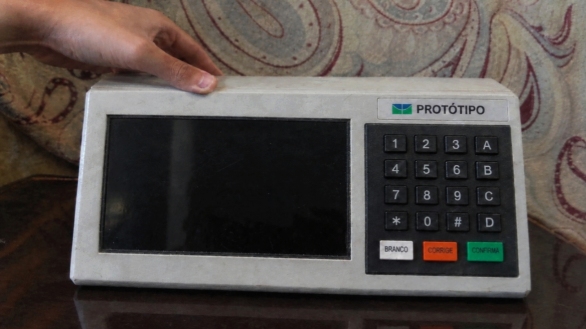

# NexusVote - urna eletrônica experimental no Raspberry Pi


## O projeto

Meu nome é Gustavo Maccedo, estudante de Engenharia de Software na UnB
(Universidade de Brasilia). Escolhi como tema do meu TCC construir uma urna
eletrônica experimental do zero: hardware dedicado rodando Linux, teclado
físico, impressão do boletim em papel e um núcleo de votação com auditoria.

A ideia nunca foi copiar a urna oficial. Eu queria entender, na prática, como
cada peça de um sistema de votação funciona: como o voto é registrado sem
vazar a escolha do eleitor, como o boletim é impresso e conferido, como o
sistema reage a queda de energia e como provar depois que nada foi alterado.

## Como foi fazer

Comecei pelo núcleo em C++20, que concentra as regras, os estados da sessão,
o journal de votos e a apuração. Por cima dele escrevi um terminal em C++
(`urna-pi`) que lê o teclado e imprime o boletim. A parte de hardware ficou
em Rust: leitura do teclado matricial via evdev, som via ALSA e piezo, driver
ESC/POS cru para a impressora térmica e leitura de energia e relógio via
sysfs. O display HDMI roda uma interface em Qt.

A parte que mais me ensinou foi a integração no Raspberry Pi: subir o teclado
matricial com device tree overlay, mapear os keycodes até a confirmação do
voto, gerar os sons de confirma e fim, e fazer a impressora cuspir um boletim
legível com QR. Cada driver novo quebrava alguma suposição minha, e o diário
de bordo (`hw-events.jsonl`) virou meu melhor amigo na hora de depurar.

Resolvi disponibilizar o código-fonte para quem estiver estudando sistemas
embarcados, Linux ou o tema de votação eletrônica na faculdade.

## O protótipo físico



Foto do terminal: display, teclado matricial 4x4 e teclas BRANCO, CORRIGE e
CONFIRMA. O software deste repositório segue esse arranjo de teclas.

Montei esse terminal em 2018, no meu TCC. Anos depois, em 2025, resolvi
atualizar o projeto: refiz o núcleo, o software do Pi e a impressão do
boletim. Este ano incluí o voto para as duas vagas de senador, como manda a
lei vigente. Cada eleitor vota duas vezes para o cargo, e repetir o mesmo
número anula o segundo voto. O código trata exatamente essa regra.

## Aviso importante

Isto é um protótipo educacional de laboratório. Eleição, eleitores e
candidatos 100% fictícios, sem validade eleitoral. Não é a urna do TSE, não
a substitui e não se conecta a nenhum sistema oficial. O sistema só opera
offline.

## Hardware usado nos testes

- 2x Raspberry Pi 4B (um de eleitor, um de mesário) + fontes 5V/3A + microSD
- Display HDMI 7 a 10 polegadas (800x480 ou 1024x600)
- Teclado de membrana matricial 4x4 via GPIO
- RTC DS3231 (tempo autoritativo) + UPS HAT com bateria
- Impressora térmica USB 58/80mm (protocolo ESC/POS)
- Piezo no GPIO18 para os sons de confirma e fim
- ATECC608, chaves tamper e lacres numerados (fase de selagem)

## Dependências

No PC (Ubuntu/Debian):

```bash
sudo apt install -y cmake ninja-build g++ libssl-dev python3 python3-pytest cargo
```

Opcional, só para a interface gráfica: `qt6-base-dev`. No Pi, o script de
instalação cuida do resto (`alsa-utils`, `evtest`, `i2c-tools`,
`device-tree-compiler` e toolchain Rust).

## Como compilar e testar

```bash
bash scripts/build_host.sh   # núcleo + urna-pi + testes
bash scripts/build_rust.sh   # HAL + daemons do Pi
bash scripts/run_tests.sh    # C++ (ctest) + Python (pytest)
```

Se o filesystem do projeto for `noexec`, exporte antes `BUILD_DIR` e
`CARGO_TARGET_DIR` para um diretório com execução (ex. `/tmp/nvbuild`).

## Como usar

```bash
export NEXUSVOTE_CONFIG=$PWD/config/demo-election.json
CLI=build/host/nexusvote-cli
$CLI --lab /tmp/nvlab/work init config/demo-election.json
$CLI --lab /tmp/nvlab/work open
$CLI --lab /tmp/nvlab/work vote-batch <fixture>
$CLI --lab /tmp/nvlab/work close
$CLI --lab /tmp/nvlab/work export /tmp/nvlab/out
python3 tools/tally_verifier_python/verify.py /tmp/nvlab/out
```

No Pi, com o hardware ligado:

```bash
sudo bash scripts/install-pi.sh && sudo reboot
sudo bash scripts/test_hw_real.sh   # tudo PASS = pronto para votar
```

## Estrutura do repositório

- `src/core/` - regras, sessão, journal, apuração e auditoria (C++20)
- `src/terminal/urna-pi.cpp` - terminal de votação do Pi
- `src/paper/` - driver ESC/POS da impressora térmica
- `src/lab/keypad_evdev.*` - leitura do teclado matricial via evdev
- `rust/crates/nv-hal/` - hardware: teclado, som, impressora, energia, RTC
- `rust/crates/nv-input-bridge/` - ponte evdev para FIFO
- `rust/crates/nv-power-daemon/` - vigia de energia e relógio
- `rust/crates/nv-secure-core/` + `nv-secure-ffi/` - journal selado e PIN do mesário
- `overlays/` - device tree do teclado 4x4 - `systemd/` - serviços do terminal
- `assets/sounds/` - sons de confirma e fim (WAV)
- `scripts/` - build, testes e provisionamento do Pi
- `tools/` - verificador independente em Python e utilidades
- `config/` - eleições fictícias de laboratório

## Licença

Apache License 2.0 (ver `LICENSE`). Copyright 2026 Gustavo Maccedo, TCC de
Engenharia de Software, Universidade de Brasilia (UnB).
